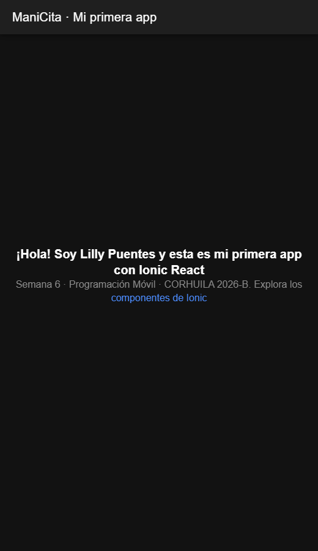

# Semana 6 · Monta tu entorno y crea tu primer proyecto

**Autora:** Lilly Puentes · Programación Móvil · CORHUILA 2026-B

Proyecto Ionic React creado con la plantilla `blank`, con el título de la pantalla inicial modificado.

## Pasos que seguí

1. **Instalar Node.js LTS** desde https://nodejs.org y comprobar la versión:

   ```bash
   node -v   # v22.20.0
   npm -v    # 11.6.1
   ```

2. **Instalar el CLI de Ionic:**

   ```bash
   npm install -g @ionic/cli
   ionic --version
   ```

3. **Crear el proyecto** con la plantilla en blanco y React:

   ```bash
   ionic start miApp blank --type=react
   cd miApp
   ```

4. **Ejecutarlo** en el navegador:

   ```bash
   ionic serve
   ```

   Se abre en http://localhost:8100 (si no tienes el CLI global, `npm run dev` hace lo mismo con Vite).

5. **Modificar la pantalla inicial:**
   - `src/pages/Home.tsx`: cambié el título `Blank` por **«ManiCita · Mi primera app»** (en los dos `IonTitle`).
   - `src/components/ExploreContainer.tsx`: cambié el texto de bienvenida.
   - `src/components/ExploreContainer.css`: agregué `padding: 0 16px` para que el texto no se pegue a los bordes en pantallas angostas.

6. **Comprobar** que compila y que pasa el test que trae la plantilla:

   ```bash
   npm run build
   npx vitest run   # 1 test pasa
   ```

## Captura de la pantalla inicial modificada



## Estructura

```
06-week/
├── README.md
└── miApp/                 proyecto generado con ionic start
    ├── capturas/pantalla-inicial.png
    └── src/
        ├── pages/Home.tsx            título modificado
        └── components/ExploreContainer.tsx
```

> `node_modules/` no se sube (está en `.gitignore`). Después de clonar: `cd miApp && npm install`.
