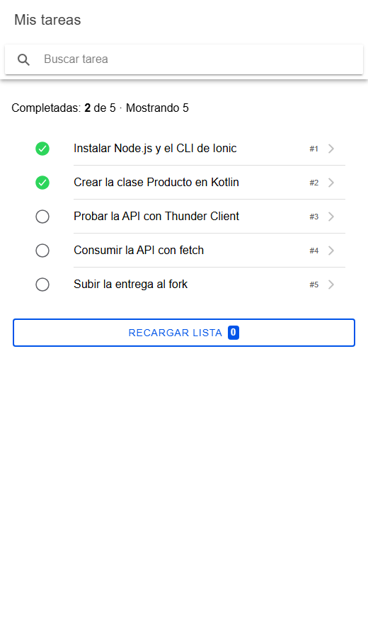
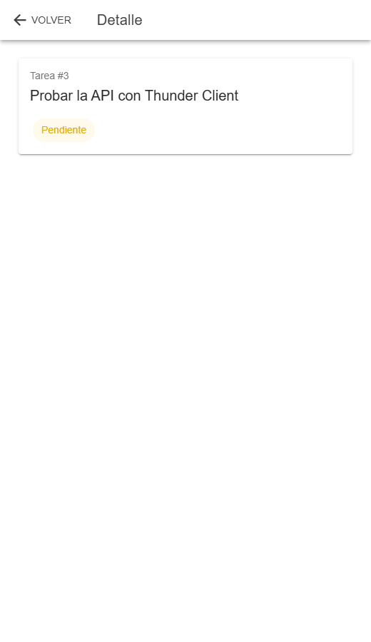
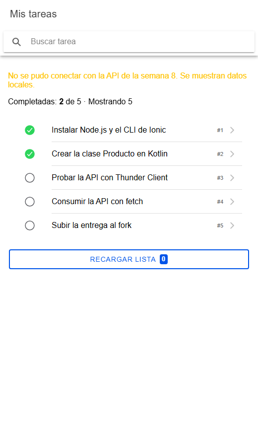

# Semana 9 · Pantalla con lista y navegación en Ionic React

**Autora:** Lilly Puentes · Programación Móvil · CORHUILA 2026-B

App Ionic React con una lista de tareas (`IonList`), estado con `useState` y navegación a una segunda página con React Router. La lista se carga desde la **API de la semana 8** con `fetch` (punto 4, «ideal»).

## Cómo ejecutar

1. Encender la API de la semana 8:

   ```bash
   cd ../08-week/api
   npm install
   npm start          # http://localhost:3000
   ```

2. En otra terminal, la app:

   ```bash
   cd lista-app
   npm install
   npm run dev        # http://localhost:5173
   ```

Si la API está apagada, la app **no se rompe**: muestra un aviso y una lista local de 5 tareas.

## Cómo se cumple cada punto

| Punto del enunciado | Dónde | Cómo |
|---|---|---|
| 1. Lista (`IonList`) con al menos 5 elementos | `src/pages/ListaTareasPage.tsx` | `IonList` con un `IonItem` por tarea, con ícono de estado (`IonIcon`), título (`IonLabel`) y número (`IonNote`). La API trae 5 tareas iniciales, y la lista local de respaldo también tiene 5. |
| 2. Contador o campo con `useState` | `ListaTareasPage.tsx` | **Campo:** `IonSearchbar` guarda el texto en `busqueda` y filtra la lista mientras se escribe. **Contador:** el botón «Recargar lista» suma 1 a `vecesRecargada`; ese cambio vuelve a pedir los datos a la API y el número se ve en el `IonBadge`. También se muestra «Completadas: X de Y · Mostrando Z». |
| 3. Segunda página con React Router | `src/App.tsx` y `src/pages/DetalleTareaPage.tsx` | Rutas `/tareas` y `/tareas/:id` dentro de `IonReactRouter`. Cada `IonItem` tiene `routerLink={`/tareas/${id}`}`. El detalle lee el id con `useParams` y tiene `IonBackButton` para volver. |
| 4. (Ideal) Cargar desde la API de la semana 8 | `src/api/tareasApi.ts` | `listarTareas()` hace `GET /tareas` y `obtenerTarea(id)` hace `GET /tareas/:id`. Los errores de red y los 404 se convierten en `ApiError`. |

## Capturas

| Lista (desde la API) | Detalle (2.ª página) | API apagada |
|---|---|---|
|  |  |  |

## Estructura

```
09-week/
├── README.md
└── lista-app/                 Vite + Ionic React + React Router
    ├── capturas/
    └── src/
        ├── App.tsx            rutas /tareas y /tareas/:id
        ├── api/tareasApi.ts   fetch a la API de la semana 8 + lista local
        └── pages/
            ├── ListaTareasPage.tsx
            └── DetalleTareaPage.tsx
```
