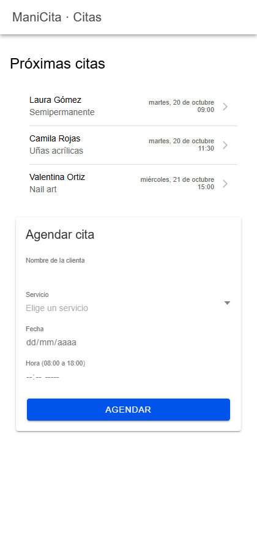
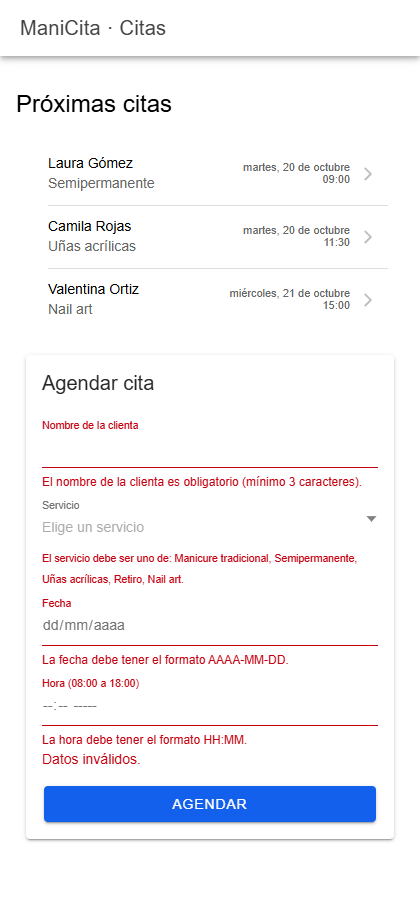
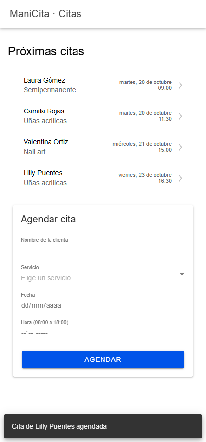
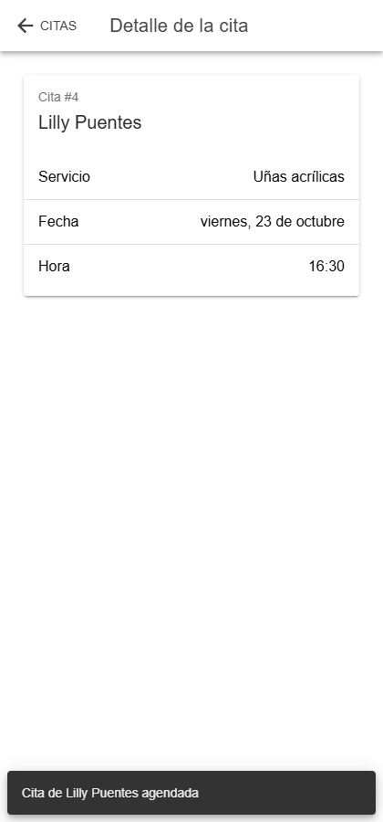
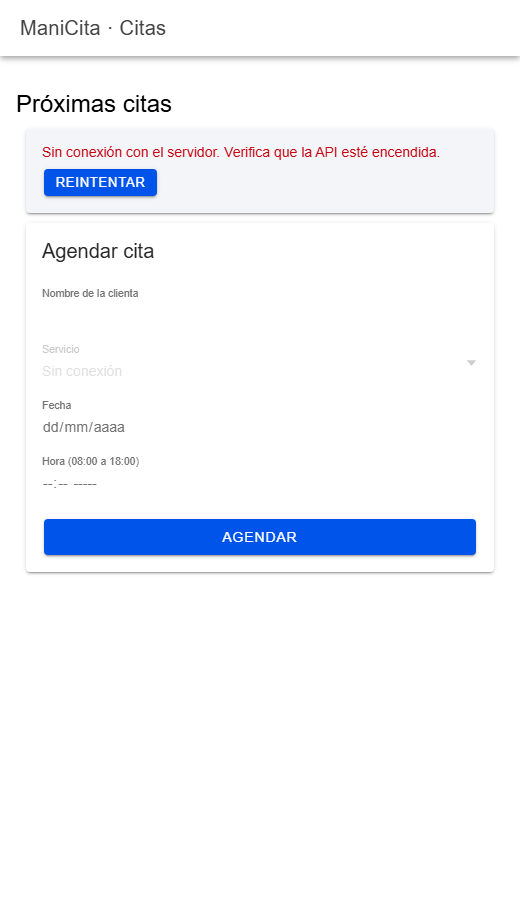

# Semana 10 · Mini-app integradora (cierre C2)

**Autora:** Lilly Puentes · Programación Móvil · CORHUILA 2026-B

Mini-app de **citas para ManiCita**. Une un backend Express con un frontend Ionic React: lista las citas, crea una nueva desde un formulario, abre el detalle y maneja los errores de red.

## Estructura

```
10-week/
├── README.md
├── api/                       backend Express (puerto 3000)
│   ├── src/app.js             rutas, validación, errores
│   ├── src/server.js
│   └── test/citas.test.js     6 pruebas (node:test)
└── app/                       frontend Ionic React + React Router (Vite)
    ├── capturas/
    └── src/
        ├── App.tsx                 rutas /citas y /citas/:id
        ├── api/citasApi.ts         fetch + ApiError + timeout
        └── pages/
            ├── CitasPage.tsx       lista + formulario
            └── DetalleCitaPage.tsx detalle
```

## Cómo ejecutar

```bash
# Terminal 1 — backend
cd api
npm install
npm start          # http://localhost:3000
npm test           # 6 pruebas

# Terminal 2 — app
cd app
npm install
npm run dev        # http://localhost:5173
```

La app apunta a `http://localhost:3000`. Para cambiar la URL, copia `.env.example` a `.env` y edita `VITE_API_URL`.

## Backend · endpoints

| Método | Ruta | Respuesta |
|---|---|---|
| GET | `/api/citas` | `200` con la lista, ordenada por fecha y hora |
| GET | `/api/citas/:id` | `200` con la cita · `404` si no existe |
| POST | `/api/citas` | `201` con la cita creada y cabecera `Location` · `400` con errores por campo · `409` si el horario ya está ocupado |
| GET | `/api/servicios` | `200` con los servicios que llenan el selector del formulario |

Cuerpo del POST:

```json
{ "cliente": "Lilly Puentes", "servicio": "Uñas acrílicas", "fecha": "2026-10-23", "hora": "16:30" }
```

**Validaciones:**

- `cliente`: mínimo 3 caracteres.
- `servicio`: debe ser uno del catálogo.
- `fecha`: una fecha real en formato `AAAA-MM-DD` (por ejemplo, `2026-02-30` se rechaza).
- `hora`: formato `HH:MM`, entre 08:00 y 18:00.

No se aceptan dos citas el mismo día a la misma hora (responde `409`). Los datos viven en memoria.

## Frontend · cómo se cumple cada punto

| Punto | Cómo |
|---|---|
| **2. Lista con fetch** | `CitasPage` llama a `citasApi.listar()` al montarse y pinta un `IonList` con clienta, servicio, fecha y hora. |
| **2. Formulario que crea** | En la misma pantalla, un `IonCard` con `IonInput` (nombre, fecha, hora) y `IonSelect` (servicio). Al enviar llama a `citasApi.crear()`. La cita nueva se agrega a la lista sin recargar y aparece un `IonToast` de confirmación. |
| **3. Navegación al detalle** | Cada `IonItem` tiene `routerLink="/citas/:id"`. `DetalleCitaPage` lee el id con `useParams`, pide `GET /api/citas/:id` y tiene `IonBackButton`. |
| **4. Errores de red** | `citasApi.ts` convierte cada fallo en un `ApiError`. Ver la tabla siguiente. |

**Manejo de errores:**

| Situación | Lo que ve el usuario |
|---|---|
| API apagada o sin internet (`fetch` lanza) | «Sin conexión con el servidor…» y botón **Reintentar**. El selector de servicios queda deshabilitado. |
| La API tarda más de 8 s (`AbortSignal.timeout`) | «La API tardó demasiado en responder…» |
| `400` al crear | El mensaje de error bajo cada campo, con el texto que manda la API. |
| `409` al crear | «Ya hay una cita a esa hora.» bajo el campo Hora. |
| `404` en el detalle | «Esta cita no existe.» (sin botón de reintentar, porque no es un problema de red). |

## Prueba de punta a punta

Se probó en Chrome con la API y la app encendidas a la vez:

1. La lista carga las 3 citas iniciales.
2. Enviar el formulario vacío muestra los 4 errores que devuelve la API.
3. Se crea la cita «Lilly Puentes · Uñas acrílicas · 23 oct · 16:30»: la lista pasa a 4 citas y aparece el toast.
4. Al tocar la cita nueva se abre `/citas/4` con su detalle.
5. Con la API apagada, la lista muestra el error de conexión y «Reintentar».

| Lista | Errores del formulario | Cita creada |
|---|---|---|
|  |  |  |

| Detalle | Sin conexión |
|---|---|
|  |  |

**Pruebas del backend (`npm test`):**

```
✔ GET /api/citas devuelve la lista en JSON
✔ POST /api/citas crea una cita (201) y aparece en el GET
✔ GET /api/citas/:id devuelve el detalle y 404 si no existe
✔ POST con datos inválidos → 400 con errores por campo
✔ POST en un horario ocupado → 409
✔ POST con JSON mal formado → 400 en JSON
# pass 6 · fail 0
```
