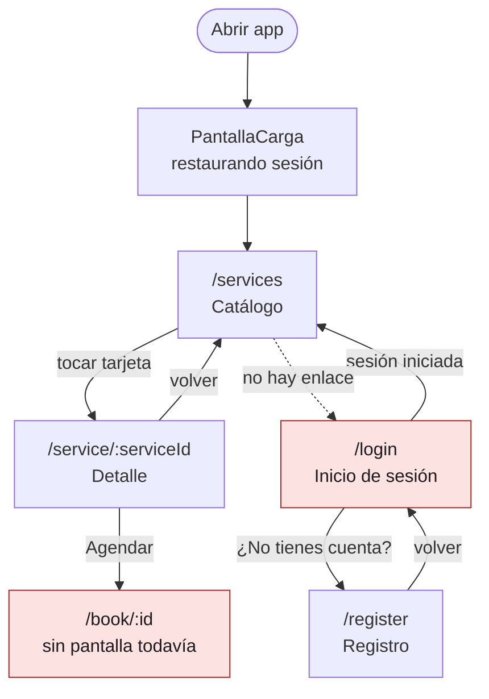

# CP1 - Auditoría UX de mis pantallas

Pantallas que audito (app ManiCita, `app/` en la línea base `d304375`):

1. **Catálogo de servicios** (`/services`, `CatalogScreen`): lista de servicios publicados, carga `GET /v1/services`.
2. **Detalle del servicio** (`/service/:serviceId`, `ServiceDetailScreen`): carga `GET /v1/services/{id}`.
3. **Inicio de sesión** (`/login`, `LoginScreen`): `POST /v1/auth/login`.

Capturas de cómo están hoy (Chrome a 500 x 900, el sistema en modo oscuro, sin la API corriendo):

| Catálogo (error) | Detalle (error) | Login |
|---|---|---|
|  |  |  |

## Hallazgos

| # | Pantalla | Problema | Principio | Severidad | Arreglo propuesto |
|---|---|---|---|---|---|
| 1 | Catálogo | Desde el catálogo no hay ningún botón para ir a iniciar sesión ni a "Mis citas"; a `/login` solo se llega escribiendo la URL | Patrón de navegación | Alta | Barra de pestañas inferior: Servicios, Mis citas, Cuenta |
| 2 | Catálogo | El estado de error muestra solo el título "No se pudo cargar el catálogo", sin decir por qué (sin conexión, servidor caído) | Retroalimentación / estados | Alta | Mensaje según el `code` del error (`NETWORK_ERROR`, `INTERNAL_ERROR`) debajo del título |
| 3 | Catálogo | No hay forma de forzar la carga lenta ni el error para probarlos; solo se ven si se apaga la API | Estados de la interfaz | Media | Variables `VITE_SIMULATE_DELAY_MS` y `VITE_SIMULATE_ERROR` en el repositorio del catálogo |
| 4 | Catálogo | Los chips de filtro (Tradicional, Semipermanente, Acrílico...) miden 32 px de alto | Área táctil mínima 44 px | Alta | `min-height: 44px` en `.mc-chip` |
| 5 | Catálogo | El botón "Todos" está escrito a mano en español y no sale de i18n como el resto de chips | Textos y etiquetas | Baja | Clave `catalogo.filtro.todos` en `es-CO.json` y `en.json` |
| 6 | Catálogo | El banner "sin conexión" se arma con `fecha: ''`, la frase queda cortada sin la fecha de la última actualización | Retroalimentación | Media | Guardar la fecha del caché y mostrarla, o quitar esa parte del texto |
| 7 | Detalle | El botón de volver es solo un ícono (`IonBackButton text=""`) y el lector de pantalla no dice a dónde vuelve | Accesibilidad (etiquetas) | Media | `aria-label="Volver al catálogo"` |
| 8 | Detalle | Al tocar la dirección del salón se copia al portapapeles pero no aparece ningún aviso; la usuaria no sabe que pasó algo | Retroalimentación de cada acción | Media | `IonToast` "Dirección copiada" y un ícono de copiar junto al texto |
| 9 | Detalle | El precio y los títulos usan tamaños fijos en px (`22px`, `28px`), no crecen si la persona sube el tamaño de letra del sistema | Accesibilidad (texto escalable) | Media | Pasar los tokens de tipografía a `rem` |
| 10 | Login | Mientras se envía el formulario el botón "Entrar" solo cambia su texto por "…", sin spinner ni texto que diga qué está pasando | Retroalimentación | Media | Spinner dentro del botón y botón deshabilitado durante el envío |
| 11 | Todas | En pantalla de 360 px la fila de chips se corta sin ninguna pista de que hay más filtros a la derecha | Comportamiento en pantalla pequeña | Baja | Degradado al borde derecho de la fila |
| 12 | Catálogo y detalle | En modo oscuro el botón "Reintentar" tiene texto blanco sobre `#e8a0bc`, contraste de 2.06 a 1 | Contraste 4.5 a 1 | Alta | Token `--color-on-brand` oscuro para el texto sobre el botón en modo oscuro |
| 13 | Catálogo y detalle | El estado de error usa un emoji (⚠️) como ilustración y el título no lleva padding lateral: en 360 px queda pegado a los bordes | Comportamiento en pantalla pequeña | Baja | Padding lateral en `.mc-empty` (se revisa en el CP4 a 360 px) |

Prioridad: primero 1, 2, 4 y 12 (alta), luego los de severidad media.

## Mapa de navegación actual

Dónde se pierde el usuario:

- **Login**: no hay ningún camino visible desde el catálogo; una persona que quiere iniciar sesión no lo encuentra.
- **Agendar**: el botón del detalle lleva a `/book/:id`, que todavía no tiene pantalla y queda en blanco.
