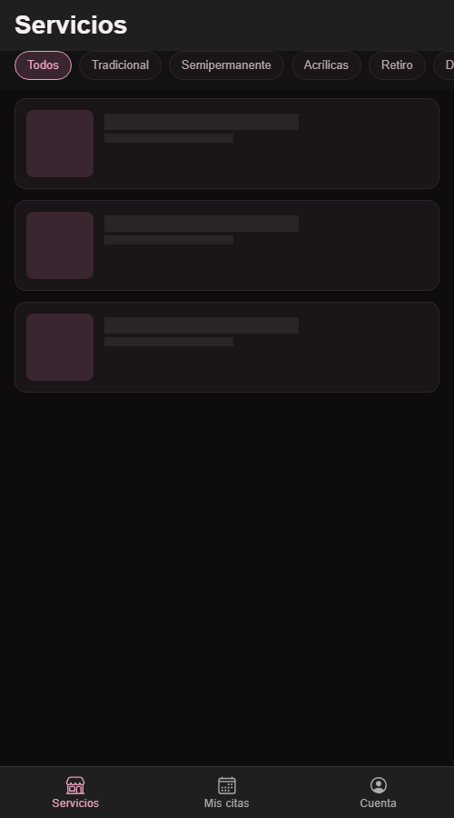
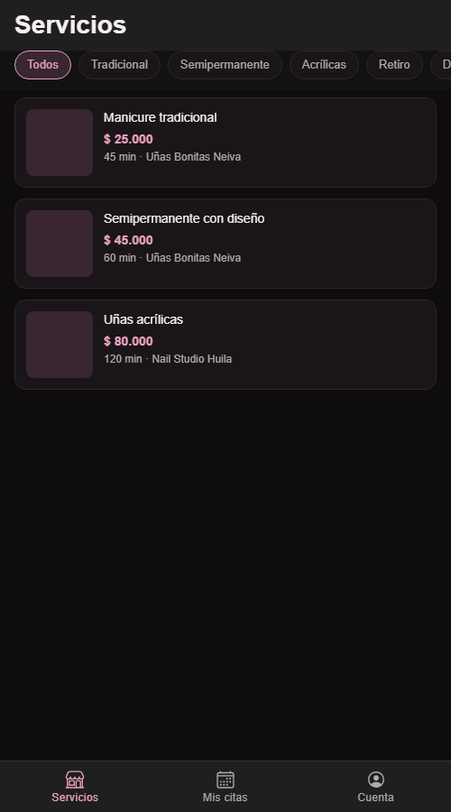
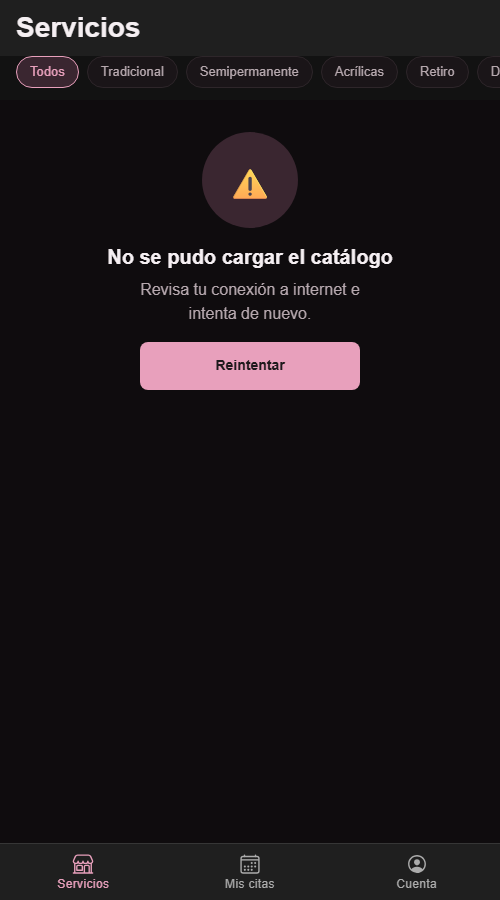
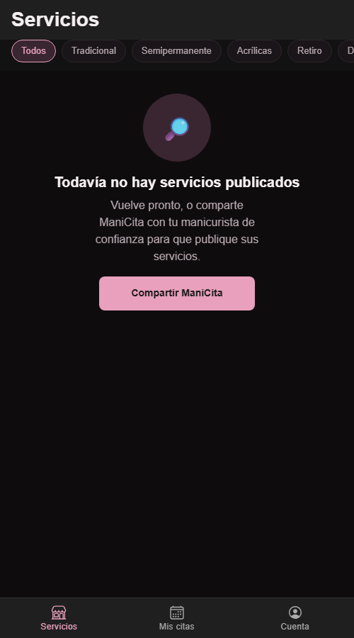

# CP3 - Catálogo de servicios con sus tres estados

Pantalla: `CatalogScreen` (`/services`), que carga `GET /v1/services` a través de `CatalogRepository`.

| Cargando | Con datos | Error | Vacío |
|---|---|---|---|
|  |  |  |  |

## Qué muestra cada estado

| Estado | Qué ve la clienta | Componente |
|---|---|---|
| Cargando | 3 tarjetas skeleton con la forma real de `TarjetaServicio` (miniatura, nombre, precio) | `TarjetaServicioSkeleton` con `IonSkeletonText` |
| Con datos | Tarjetas con nombre del servicio, precio en COP, duración y salón | `TarjetaServicio` |
| Error | "No se pudo cargar el catálogo" + "Revisa tu conexión a internet e intenta de nuevo." + botón Reintentar | `EstadoVacio` |
| Vacío | "Todavía no hay servicios publicados" (o "Ningún servicio de este tipo" con filtro, y botón para ver todos) | `EstadoVacio` |

Antes el estado de error no tenía mensaje (`message=""`), solo el título (hallazgo 2 de la auditoría).
Deslizar hacia abajo recarga la lista con `IonRefresher`, manteniendo el filtro elegido.

## Cómo forzar cada estado

`SimulatedCatalogRepository` envuelve al repositorio real. Se controla con parámetros en la URL
(más rápido para probar) o con variables en `.env`:

| Estado | URL | `.env` |
|---|---|---|
| Cargando | `/services?simulate=demo&delay=60000` | `VITE_SIMULATE=demo` y `VITE_SIMULATE_DELAY_MS=60000` |
| Con datos | `/services?simulate=demo` | `VITE_SIMULATE=demo` |
| Error | `/services?simulate=error` | `VITE_SIMULATE=error` |
| Vacío | `/services?simulate=empty` | `VITE_SIMULATE=empty` |
| Real (API) | `/services` | `VITE_SIMULATE=off` |

Sin la API corriendo, el modo real también termina en el estado de error.

## Prueba automatizada

`app/src/features/catalog/presentation/CatalogScreen.test.tsx` (Vitest + Testing Library):

- `CatalogScreen_whenServicesFail_showsErrorMessageWithRetry`: el repositorio falla y la pantalla muestra el título, el mensaje y el botón Reintentar.
- `CatalogScreen_whenRetryIsPressed_requestsServicesAgainAndShowsThem`: la primera llamada falla, la segunda devuelve "Manicure tradicional"; al tocar Reintentar se llama dos veces al repositorio y aparece el servicio.

```bash
cd 11-week/workshop/app
npm run test.unit -- --run
```
