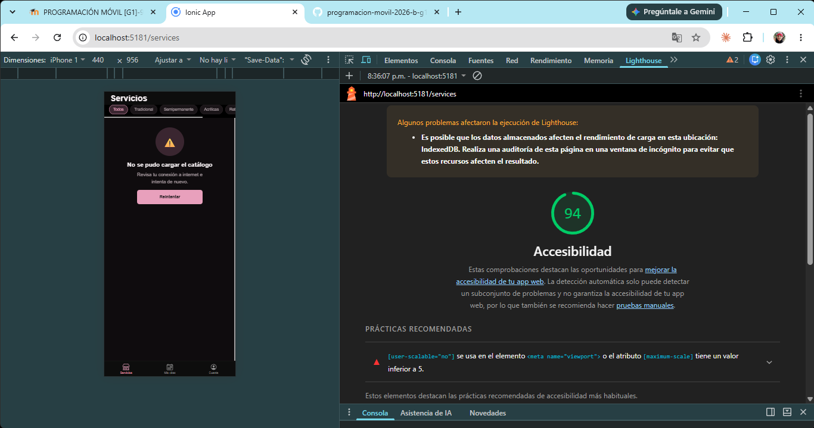
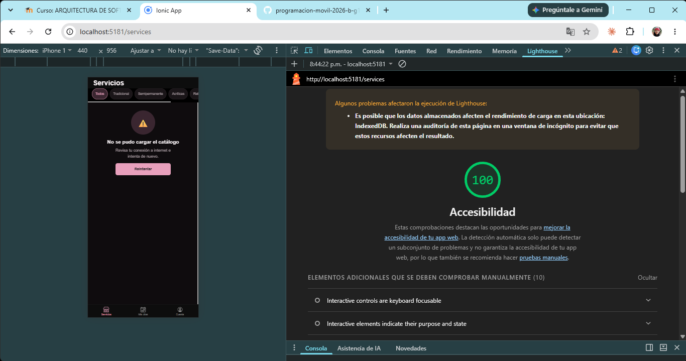
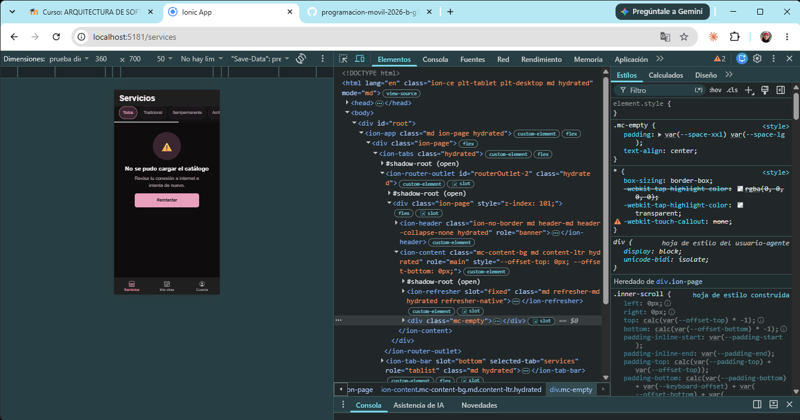
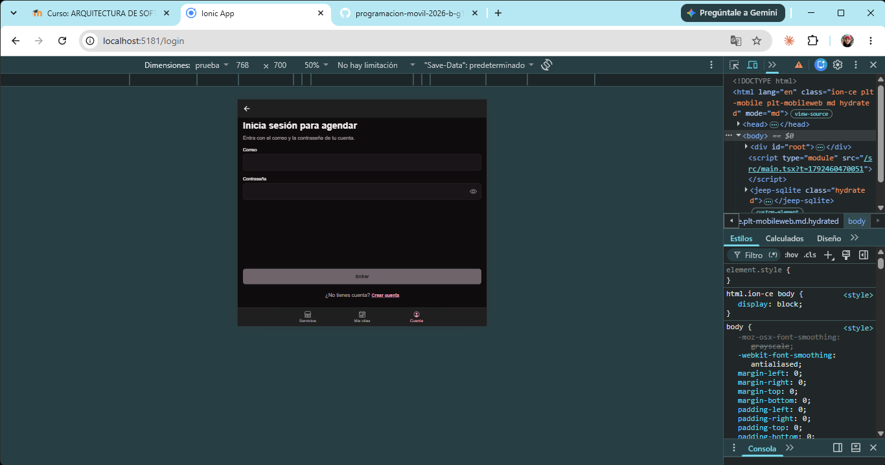

# CP4 - Accesibilidad y diseño responsivo

Pantallas revisadas: Catálogo (`/services`), Detalle del servicio (`/service/:serviceId`) e Inicio de sesión (`/login`).

## Lo que se corrigió

| Problema | Dónde | Corrección |
|---|---|---|
| No se podía hacer zoom con dos dedos (`user-scalable=no`, `maximum-scale=1.0`). Es el único fallo que marcó Lighthouse | `index.html` | Meta viewport solo con `width=device-width, initial-scale=1.0, viewport-fit=cover` |
| Chips de filtro de 32 px de alto (hallazgo 4) | `.mc-chip` en `tokens.css` | `min-height: var(--touch-target)` = 44 px |
| Enlaces "Crear cuenta" / "Iniciar sesión" de 32 px de alto | `.mc-link` | `min-height: var(--touch-target)` |
| Botón de volver solo con ícono, sin nombre para el lector de pantalla (hallazgo 7) | Detalle, Login y Registro | `aria-label="Volver al catálogo"` en `IonBackButton` |
| La dirección del salón es un botón que copia, pero el lector solo leía la dirección | Detalle | `aria-label="Copiar dirección: …"` y alto mínimo de 44 px |
| Textos con tamaño fijo en px que no crecen con la letra del sistema (hallazgo 9) | Chips y precio del detalle | `0.8125rem` y `1.375rem` (más los tokens `--font-size-*` del CP2) |
| Título del estado vacío/error pegado a los bordes en pantallas angostas (hallazgo 13) | `.mc-empty` | Padding lateral de 8 px a 16 px |
| Texto blanco sobre rosado en modo oscuro, contraste 2.06 a 1 (hallazgo 12) | Botones | Ya corregido en el CP2 con `--color-on-brand` (8.32 a 1) |
| La única forma de saber qué chip está activo era el color | Chips | Ya tenían `aria-pressed`, el lector anuncia "presionado"; se mantiene |

## Lighthouse (Accesibilidad, móvil, `/services`)

| | Puntaje | Captura |
|---|---|---|
| Antes | 94 |  |
| Después | 100 |  |

## Capturas a 360 px y 768 px

Tomadas con las herramientas de desarrollador de Chrome en modo dispositivo (Responsive).

| Catálogo a 360 x 700 | Login a 768 x 700 |
|---|---|
|  |  |

A 360 px los chips de filtro siguen en una sola fila con desplazamiento horizontal y las tres pestañas
caben completas. A 768 px el formulario de login ocupa todo el ancho y el botón "Entrar" queda abajo,
junto al enlace "Crear cuenta", sin cortes.
