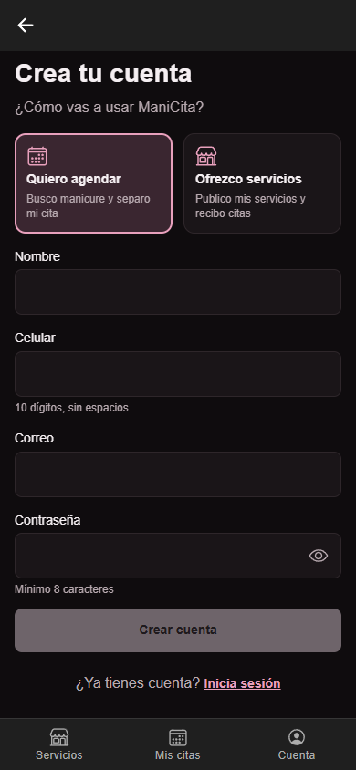
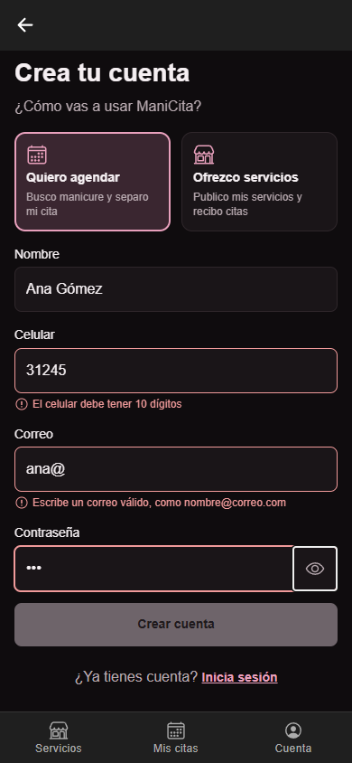
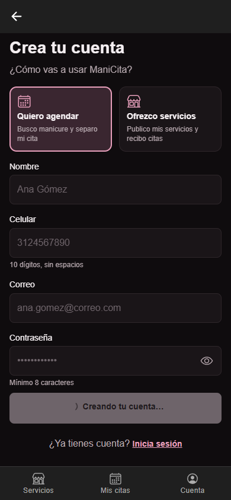
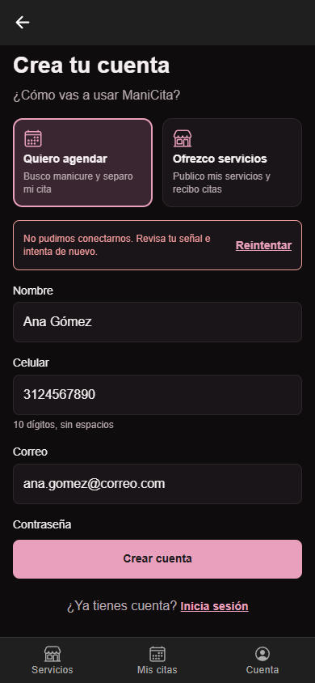
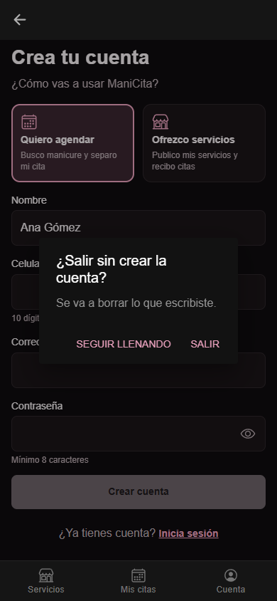
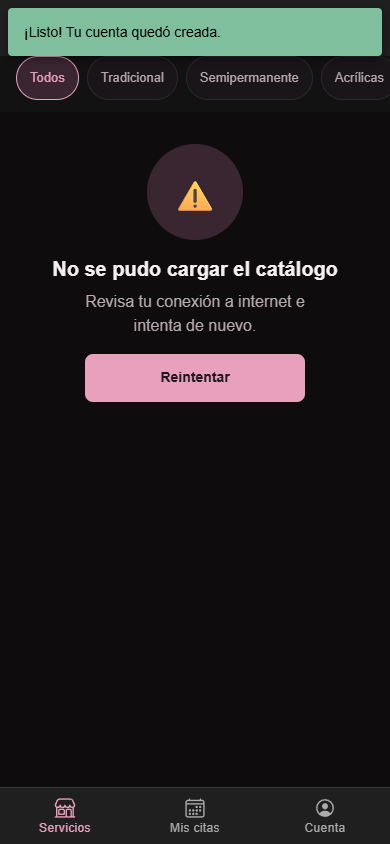

# CP6 - Formulario de registro con validación y retroalimentación

Formulario: **Crea tu cuenta** (`/register`, `SignUpScreen`), que llama a `POST /v1/auth/register` (E-01 del contrato).
Es la puerta de entrada de ManiCita: sin cuenta, la clienta no puede agendar y el salón no puede publicar servicios.

## Reglas de validación y por qué existen

Las reglas viven en `features/auth/domain/validateSignUp.ts` y son las mismas que revisa la API.
La app las revisa antes para no gastar un viaje al servidor en un error que se ve a simple vista.

| Campo | Regla | Mensaje | Por qué existe en ManiCita |
|---|---|---|---|
| Rol | Elegir "Quiero agendar" u "Ofrezco servicios" | "Elige primero cómo vas a usar ManiCita" | La clienta y el salón ven pantallas distintas; sin rol no se sabe a dónde llevarla al terminar |
| Nombre | Obligatorio | "Este campo es obligatorio" | El salón ve el nombre en su agenda para saber a quién atiende |
| Celular | Obligatorio, exactamente 10 dígitos | "El celular debe tener 10 dígitos" | Los celulares en Colombia tienen 10 dígitos; el salón lo usa para confirmar o mover la cita |
| Correo | Obligatorio, formato `nombre@dominio.algo` | "Escribe un correo válido, como nombre@correo.com" | Es el usuario para iniciar sesión y no se puede repetir (si ya existe, la API responde `EMAIL_TAKEN`) |
| Contraseña | Mínimo 8 caracteres | "La contraseña debe tener al menos 8 caracteres" | Mismo mínimo que exige la API; protege la cuenta y las citas de la clienta |
| Nombre del salón (solo salón) | Obligatorio | "Este campo es obligatorio" | Aparece en cada tarjeta del catálogo ("Uñas Bonitas Neiva"), la clienta elige por él |
| Dirección (solo salón) | Obligatoria | "Este campo es obligatorio" | La clienta necesita saber a dónde ir; se muestra en el detalle del servicio y se puede copiar |

## Retroalimentación que se agregó

| Qué pide la guía | Cómo quedó |
|---|---|
| Mensaje debajo de cada campo | Ya existía: el error aparece al salir del campo, con ícono y borde rojo (`CampoFormulario`, `aria-invalid`) |
| Botón deshabilitado mientras haya errores | **Nuevo.** "Crear cuenta" queda gris mientras falte el rol, un campo o un dato tenga mal formato. El lector de pantalla dice "Completa los campos marcados para continuar" |
| Indicador de carga | **Nuevo.** Antes el botón solo cambiaba a "…"; ahora muestra un spinner y "Creando tu cuenta…" (`BotonPrimario`, prop `loadingLabel`) |
| Toast de éxito | **Nuevo.** `IonToast` verde arriba: "¡Listo! Tu cuenta quedó creada.", que se sigue viendo al llegar al catálogo |
| Mensaje si el servidor falla | Ya existía: banner "No pudimos conectarnos. Revisa tu señal e intenta de nuevo." con Reintentar, sin borrar lo escrito |
| Confirmación antes de una acción destructiva | **Nuevo.** Si ya escribió algo y toca volver o "Inicia sesión", `IonAlert` pregunta "¿Salir sin crear la cuenta? Se va a borrar lo que escribiste." con "Seguir llenando" y "Salir" |

## Capturas

| Vacío (botón deshabilitado) | Errores en los campos | Enviando |
|---|---|---|
|  |  |  |

| Falla del servidor | Confirmar salida | Éxito |
|---|---|---|
|  |  |  |

Sin la API corriendo, las capturas de "Enviando", "Falla del servidor" y "Éxito" se tomaron respondiendo la petición
`/auth/register` desde las herramientas del navegador (sin respuesta, conexión rechazada y respuesta 201).
