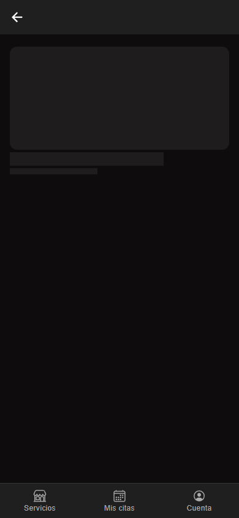
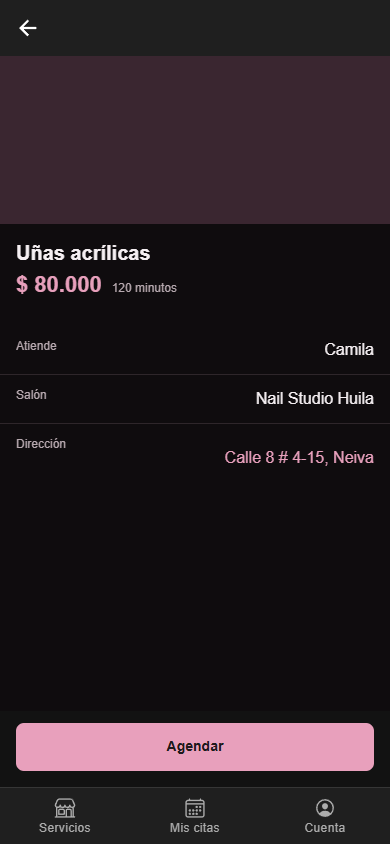
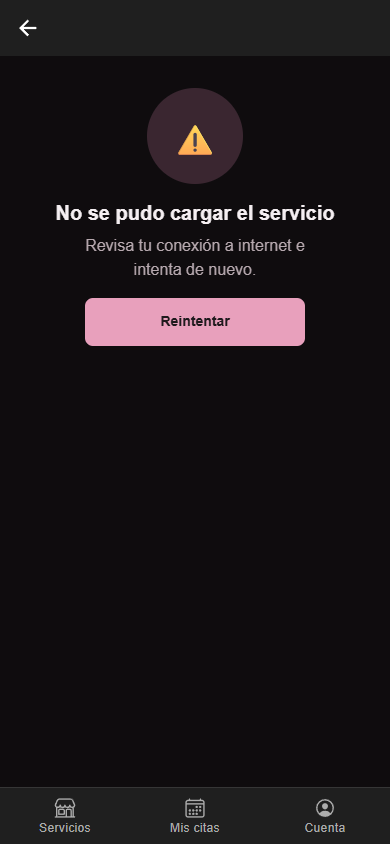
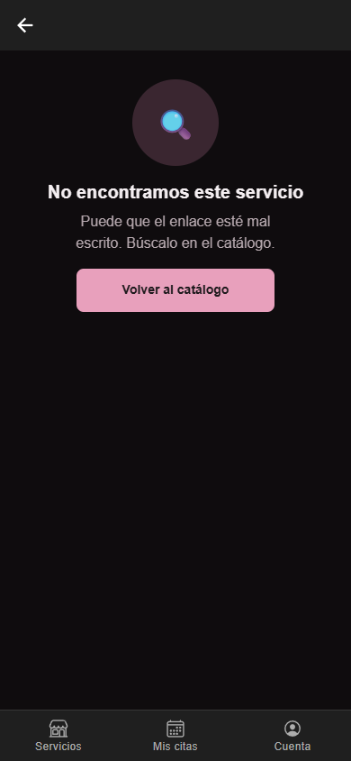
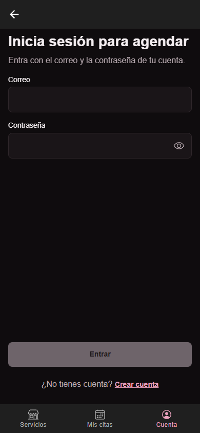
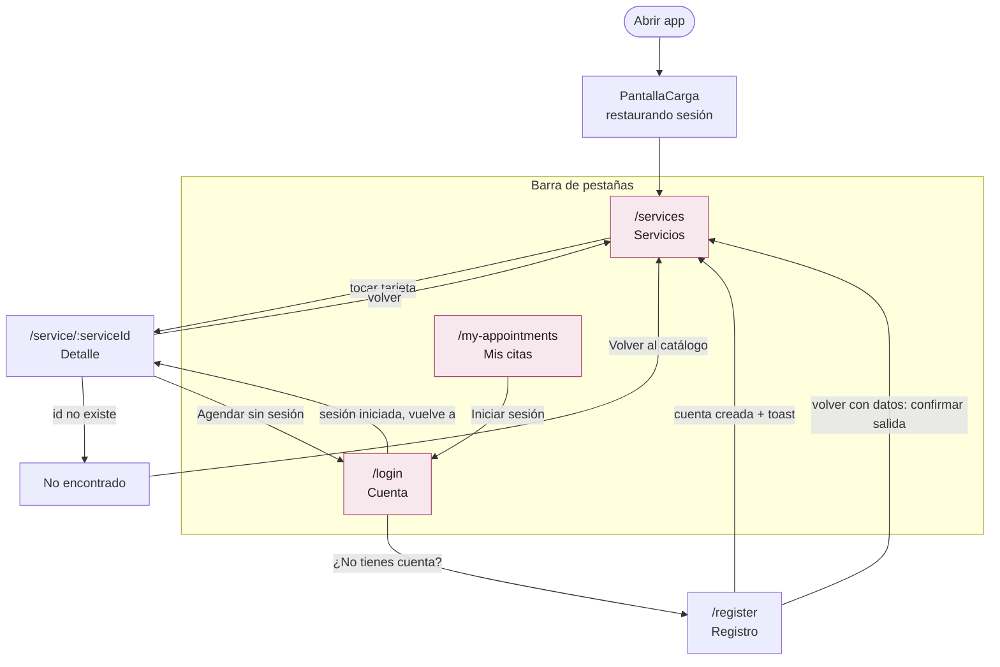

# CP7 - Detalle del servicio y flujo completo de navegación

## Pantalla de detalle

`ServiceDetailScreen` se abre desde la tarjeta del catálogo y recibe el identificador por la ruta
`/service/:serviceId` (por ejemplo `/service/svc_demo_3`). Tiene botón de volver (`IonBackButton` con
`aria-label="Volver al catálogo"`) y estos estados:

| Estado | Cuándo | Qué ve la clienta |
|---|---|---|
| Cargando | Mientras llega `GET /v1/services/{id}` | Skeleton con la forma de la foto, el nombre y el precio |
| Con datos | La API responde 200 | Nombre, precio, duración, quién atiende, salón, dirección (se copia con un toque y sale el toast "Dirección copiada") y botón Agendar |
| Error | Falla de red o del servidor | "No se pudo cargar el servicio" + "Revisa tu conexión a internet e intenta de nuevo." + Reintentar |
| **No encontrado (nuevo)** | La API responde 404: el id no existe | "No encontramos este servicio" + "Puede que el enlace esté mal escrito. Búscalo en el catálogo." + Volver al catálogo |
| Ya no disponible | La API responde 410: el salón lo pausó o eliminó | "Este servicio ya no está disponible" + Volver al catálogo |

Antes de este checkpoint el 404 y el 410 caían en el mismo estado y siempre decían "ya no está disponible",
aunque el servicio nunca hubiera existido.

| Cargando | Con datos | Error | No encontrado |
|---|---|---|---|
|  |  |  |  |

Para forzar cada estado: `/service/svc_demo_3?simulate=demo&delay=60000` (cargando),
`/service/svc_demo_3?simulate=demo` (con datos), `?simulate=error` (error) y
`/service/svc_no_existe?simulate=demo` (no encontrado).

Pruebas en `app/src/features/catalog/presentation/ServiceDetailScreen.test.tsx`:
id inexistente muestra "No encontramos este servicio" y vuelve al catálogo; error y Reintentar muestran el servicio.

## Agendar sin sesión

Antes, el botón Agendar llevaba a `/book/:id`, una ruta sin pantalla: la clienta quedaba frente a una pantalla vacía
(hallazgo del mapa del CP1). Ahora:

- **Sin sesión:** lleva a "Inicia sesión para agendar" y guarda el detalle como ruta de regreso (`state.from`);
  al iniciar sesión vuelve al mismo servicio.
- **Con sesión:** muestra el toast "Muy pronto vas a poder agendar desde aquí." hasta que llegue HU-15.

## Mapa de navegación nuevo

## Comparación con el mapa del CP1

| Tarea | Antes (CP1) | Ahora | Ahorro |
|---|---|---|---|
| Iniciar sesión desde el catálogo | No había camino: había que escribir `/login` en la barra | 1 toque en la pestaña Cuenta | De imposible a 1 paso |
| Ver "Mis citas" | No existía en la navegación | 1 toque en la pestaña Mis citas | Sección visible siempre |
| Agendar un servicio sin cuenta | Detalle → Agendar → pantalla en blanco (se pierde) | Detalle → Agendar → login → vuelve al mismo detalle | No tiene que buscar el servicio otra vez (ahorra volver al catálogo, filtrar y tocar la tarjeta: 3 pasos) |
| Abrir un enlace a un servicio que no existe | "Ya no está disponible", aunque nunca existió | "No encontramos este servicio" con salida al catálogo | Mensaje correcto |
| Crear cuenta y arrepentirse | Al volver se perdía lo escrito sin avisar | Pregunta antes de borrar | Evita perder el formulario |

Los dos puntos donde la usuaria se perdía en el CP1 (login sin camino y `/book/:id` vacío) quedaron resueltos.
