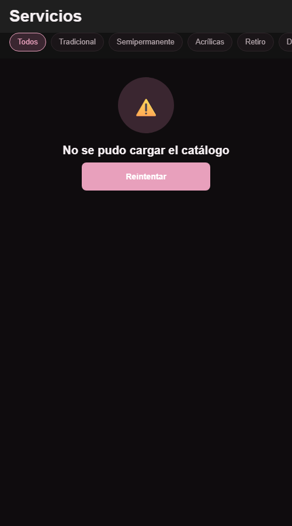
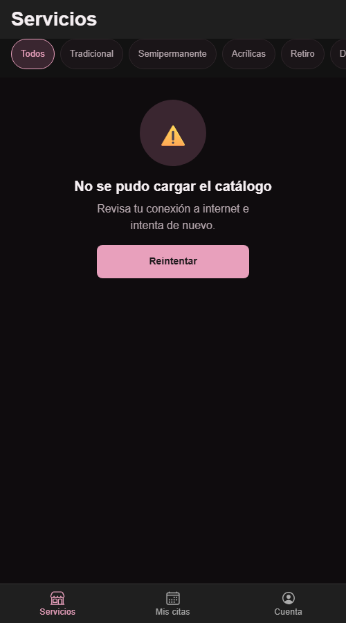
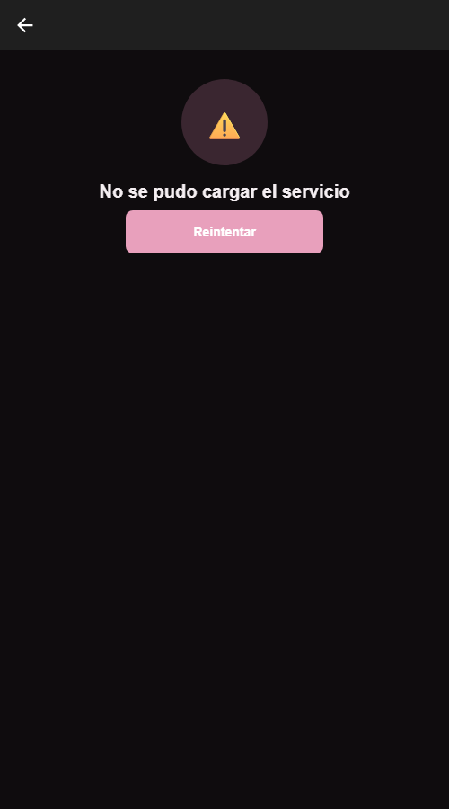
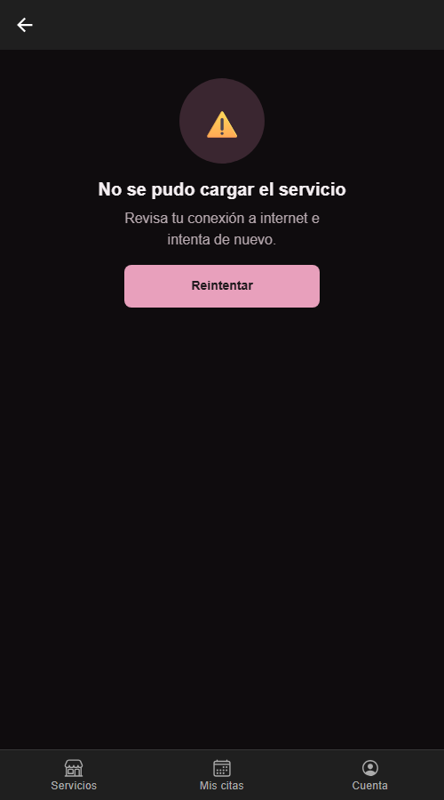
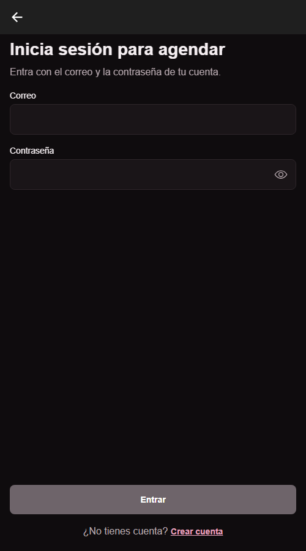
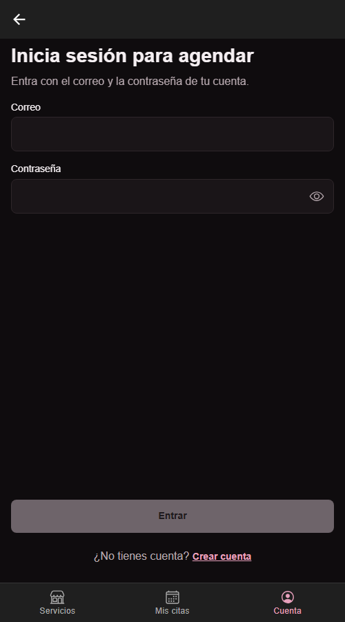

# CP9 - Antes y después, e historias para el equipo

Capturas en Chrome a 500 x 900, modo oscuro del sistema. "Antes" es la línea base (`beauty-salon-app` commit `d304375`);
"después" es `app/` al terminar el taller.

## Catálogo de servicios (`/services`)

| Antes | Después |
|---|---|
|  |  |

- **Qué cambió:** el error ahora explica qué hacer ("Revisa tu conexión a internet e intenta de nuevo."), el botón
  Reintentar tiene texto oscuro y abajo aparece la barra de pestañas Servicios / Mis citas / Cuenta.
- **Principios:** retroalimentación (el error dice la causa y la salida), contraste 4.5 a 1 (de 2.06 a 8.32 a 1)
  y patrón de navegación (las 3 secciones a un toque).

| Con datos (después) | Cargando (después) |
|---|---|
|  |  |

- **Qué cambió:** los chips de filtro pasaron de 32 a 44 px de alto y los tamaños de letra van en `rem`.
- **Principios:** área táctil mínima de 44 px y texto escalable.

## Detalle del servicio (`/service/:serviceId`)

| Antes | Después |
|---|---|
|  |  |

- **Qué cambió:** el error trae mensaje, el botón de volver tiene nombre para el lector de pantalla
  ("Volver al catálogo"), hay estado "No encontrado" separado de "Ya no disponible", y Agendar sin sesión lleva al
  login y vuelve al mismo servicio en vez de abrir una pantalla en blanco.
- **Principios:** estados de la interfaz, accesibilidad (etiquetas) y no dejar a la usuaria sin salida.

| No encontrado (después) | Agendar sin sesión (después) |
|---|---|
|  |  |

## Inicio de sesión (`/login`) y registro (`/register`)

| Antes | Después |
|---|---|
|  |  |

- **Qué cambió:** se llega desde la pestaña Cuenta (antes no había camino desde el catálogo), la pestaña queda
  marcada para saber dónde se está y el enlace "Crear cuenta" tiene 44 px de alto.
- **Principios:** patrón de navegación y área táctil.

| Registro con errores (después) | Registro enviando (después) | Registro exitoso (después) |
|---|---|---|
|  |  |  |

- **Qué cambió:** botón deshabilitado mientras haya errores, spinner con "Creando tu cuenta…", toast de éxito y
  confirmación antes de salir con datos escritos.
- **Principios:** prevenir el error antes de que ocurra, retroalimentación de cada acción y confirmación de acciones destructivas.

Lighthouse Accesibilidad en `/services`: **94 → 100** (ver `04-a11y-responsive.md`).

---

## Historias de usuario para el backlog del equipo

Con la misma plantilla de las HU del equipo en el proyecto "Beauty Salon — Backlog". El número lo asigna el equipo
al crearlas en el tablero. Todas son para `beauty-salon-app`.

### Historia 1 - Navegación por pestañas y regreso al servicio después de iniciar sesión

**Como** clienta que explora el catálogo sin cuenta, **necesito** llegar a Servicios, Mis citas y Cuenta desde
cualquier pantalla y volver al servicio que estaba mirando cuando inicio sesión, **para** agendar sin perderme ni
buscar el servicio otra vez.

**Tareas**
- Pasar `PublicStack` a `IonTabs` con las pestañas Servicios (`/services`), Mis citas (`/my-appointments`) y Cuenta (`/login`).
- Pantalla "Mis citas" sin sesión con acción "Iniciar sesión" (la lista real queda para HU-16).
- Botón Agendar del detalle: sin sesión navega a `/login` con `state.from` = ruta del detalle.
- Actualizar `navigation.md` en `beauty-salon-docs`.

**Criterios de aceptación**
- Dado que estoy en `/services`, cuando toco "Cuenta", entonces veo "Inicia sesión para agendar" en un solo toque.
- Dado que estoy en el detalle de un servicio sin sesión, cuando toco "Agendar" e inicio sesión, entonces vuelvo al
  detalle de ese mismo servicio.
- Cada botón de la barra tiene `aria-label` y el lector de pantalla anuncia la pestaña activa como seleccionada.
- `RootNavigator.test.tsx` pasa con la nueva pestaña.

**Entregable:** commit en `main` de `beauty-salon-app` + `navigation.md` actualizado.

### Historia 2 - Estados de carga, error, vacío y no encontrado en catálogo y detalle

**Como** clienta con mala señal, **necesito** saber si el catálogo o un servicio está cargando, si falló o si no
existe, y tener cómo reintentar, **para** no quedarme frente a una pantalla en blanco sin saber qué pasa.

**Tareas**
- Mensaje de causa en el estado de error del catálogo y del detalle (`catalogo.error.mensaje`, `servicio.detalle.mensajeError`).
- Separar en `useServiceDetailStore` el 404 (`notFound`) del 410 (`gone`).
- `SimulatedCatalogRepository` con `?simulate=error|empty|demo&delay=ms` para probar los estados sin apagar la API.
- Pruebas `CatalogScreen.test.tsx` y `ServiceDetailScreen.test.tsx`.

**Criterios de aceptación**
- Con `?simulate=demo&delay=3000` se ven 3 tarjetas skeleton durante 3 segundos y luego los servicios.
- Con `?simulate=error` se ve "No se pudo cargar el catálogo", el mensaje de causa y Reintentar; al tocarlo se vuelve a pedir la lista.
- `/service/<id que no existe>` muestra "No encontramos este servicio" y un botón que vuelve al catálogo.
- `npm run test.unit -- --run` pasa con las 4 pruebas nuevas.

**Entregable:** commit en `main` de `beauty-salon-app` con las pruebas pasando.

### Historia 3 - Accesibilidad mínima y formulario de registro con retroalimentación

**Como** persona que usa el celular con letra grande, lector de pantalla o dedos grandes, **necesito** poder hacer
zoom, tocar los controles sin fallar y saber qué pasa cuando me registro, **para** usar ManiCita sin ayuda.

**Tareas**
- Quitar `user-scalable=no` y `maximum-scale` del meta viewport de `index.html`.
- Token `--touch-target: 44px` en chips y enlaces; tokens de tipografía en `rem`; token `--color-on-brand`.
- `aria-label` en todos los botones que solo tienen ícono.
- Registro: botón deshabilitado con errores, spinner con texto, `IonToast` de éxito e `IonAlert` antes de salir con datos escritos.

**Criterios de aceptación**
- Lighthouse, categoría Accesibilidad, en `/services` y `/login` (móvil) da 95 o más.
- Ningún control táctil mide menos de 44 px de alto (revisado en DevTools a 360 px).
- Todo texto sobre fondo de color tiene contraste de al menos 4.5 a 1 en modo claro y oscuro.
- En `/register`, con un campo mal escrito "Crear cuenta" está deshabilitado; al crear la cuenta aparece "¡Listo! Tu cuenta quedó creada."
- Si escribí algo y toco volver, aparece "¿Salir sin crear la cuenta?" y "Seguir llenando" no borra nada.

**Entregable:** commit en `main` de `beauty-salon-app` + puntajes de Lighthouse en `04-quality` de `beauty-salon-docs`.
