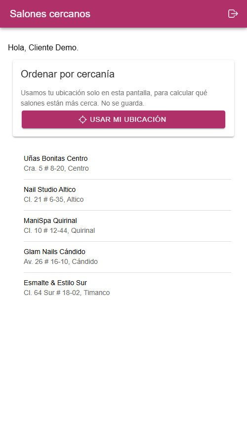
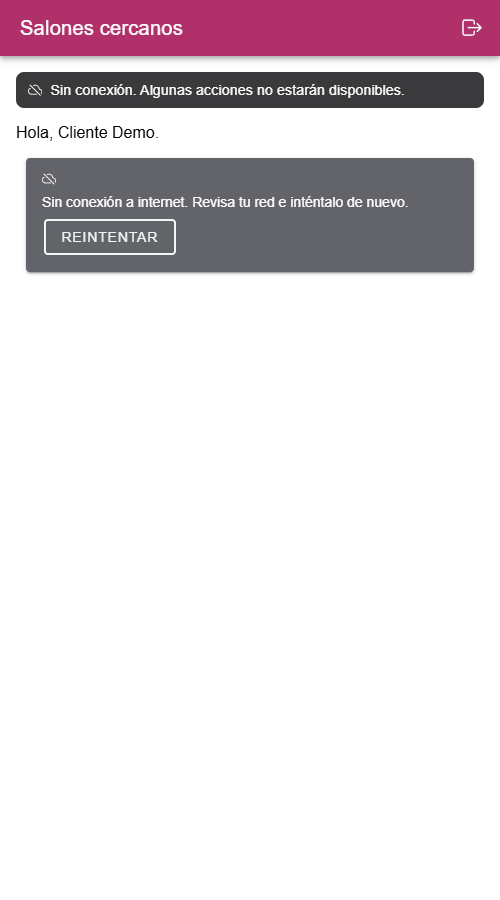
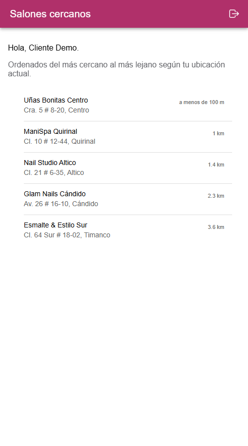
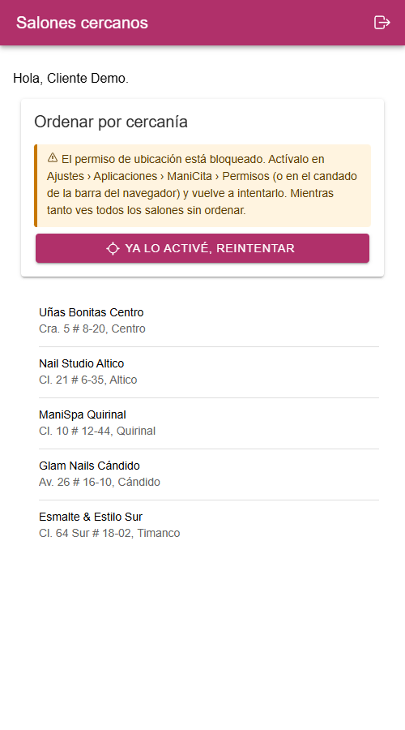
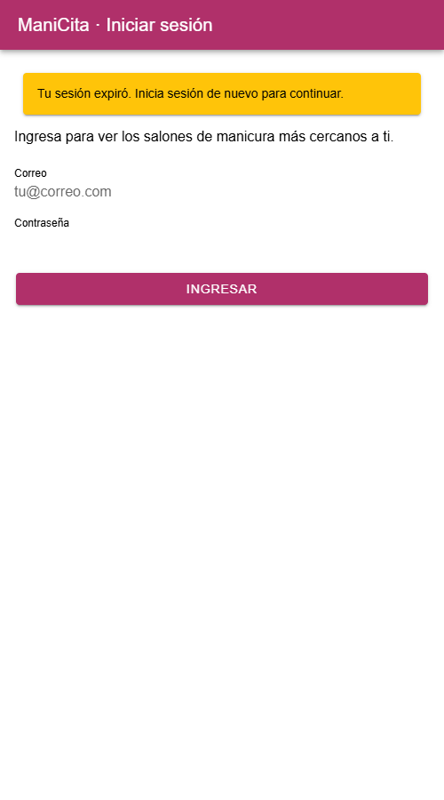

# Corte 3 — App con hardware y conectividad (c3-activity)

**Estudiante:** Lilly Puentes (`LillyPuentes-2003`)
**Curso:** Programación Móvil 2026-B · G1 — CORHUILA
**Semana:** 14 · Actividad calificable (5.0)

Mini-proyecto basado en ManiCita: la clienta inicia sesión y ve los **salones de manicura más
cercanos** usando el **GPS** del celular.

| Carpeta | Qué es | Tecnología |
| --- | --- | --- |
| [`api/`](api/) | API con login por token y una ruta protegida | Node.js 22 + Express 5 (datos en memoria) |
| [`app/`](app/) | App móvil: login, ruta protegida, GPS con permisos, errores 401 / sin red | Ionic React 9 + Capacitor 8 + Vite |
| [`capturas/`](capturas/) | Capturas de la app funcionando | — |

## Cómo ejecutar

Se necesitan **dos terminales** (primero la API, luego la app).

```bash
# Terminal 1 — API (http://localhost:3000)
cd api
npm install
npm start
```

```bash
# Terminal 2 — App (http://localhost:5173)
cd app
npm install
npm run dev
```

**Usuario de prueba:** `cliente@manicita.co` / `Manicita123`

Si la API corre en otra dirección (emulador Android → `http://10.0.2.2:3000`, celular real → IP del PC),
copiar `app/.env.example` a `app/.env` y cambiar `VITE_API_URL`.

Para probar rápido la **sesión expirada (401)**, arrancar la API con un token de 30 segundos:

```bash
# Linux / macOS / Git Bash
TOKEN_TTL_SECONDS=30 npm start
# Windows cmd
set TOKEN_TTL_SECONDS=30 && npm start
```

### En Android (plugin nativo)

Requiere Android Studio. El proyecto nativo ya está en `app/android/` con los permisos de ubicación
declarados en `AndroidManifest.xml`.

```bash
cd app
npm run cap:sync      # compila la web y la copia a android/
npm run cap:android   # abre Android Studio → Run
```

## Endpoints de la API

| Método | Ruta | Protegida | Respuesta |
| --- | --- | --- | --- |
| POST | `/api/auth/login` | No | `200 { token, expiresIn, user }` · `400` faltan datos · `401 INVALID_CREDENTIALS` |
| GET | `/api/salons?lat=&lng=` | **Sí** (`Authorization: Bearer <token>`) | `200` salones (con `distanceKm` y ordenados si llegan coordenadas) · `400` coordenadas inválidas · `401 TOKEN_MISSING / TOKEN_INVALID / TOKEN_EXPIRED` |

El token es un JWT HS256 firmado con `node:crypto` (sin librerías extra); dura 15 minutos
(`TOKEN_TTL_SECONDS`). Las contraseñas se guardan como hash `scrypt`, nunca en texto plano.

Prueba manual con `curl` (salida real):

```bash
$ curl -i http://localhost:3000/api/salons
HTTP/1.1 401 Unauthorized
WWW-Authenticate: Bearer
{"code":"TOKEN_MISSING","message":"Debes iniciar sesión."}

$ curl -i -X POST http://localhost:3000/api/auth/login -H "Content-Type: application/json" -d '{"email":"cliente@manicita.co","password":"mala"}'
HTTP/1.1 401 Unauthorized
{"code":"INVALID_CREDENTIALS","message":"Correo o contraseña incorrectos."}

$ curl -i "http://localhost:3000/api/salons?lat=2.9321&lng=-75.2745" -H "Authorization: Bearer <token>"
HTTP/1.1 200 OK
[{"id":3,"name":"ManiSpa Quirinal","address":"Cl. 10 # 12-44, Quirinal","lat":2.9321,"lng":-75.2745,"distanceKm":0}, ...]
```

## Pruebas

```bash
cd app
npm test     # prueba unitaria (Vitest) del cliente HTTP: token, 401, sin red, servidor caído
```

```
 ✓ src/core/apiClient.test.ts (5 tests)
      Tests  5 passed (5)
```

```bash
cd api
npm test     # pruebas de la API (node:test): login, 401 sin token / token alterado / expirado, 200, 400
```

```
# pass 7
# fail 0
```

## Qué cubre la entrega (rúbrica)

| Criterio | Dónde está |
| --- | --- |
| **Plugin + permisos** | `@capacitor/geolocation` en `app/src/core/location.ts`: `checkPermissions()` → `requestPermissions()` (nativo) → `getCurrentPosition()` con timeout. Permisos `ACCESS_COARSE_LOCATION` y `ACCESS_FINE_LOCATION` en `app/android/app/src/main/AndroidManifest.xml`. Si se niega, la pantalla explica cómo activarlo y sigue mostrando los salones sin ordenar. |
| **Token + 401 + sin red** | `app/src/core/apiClient.ts` agrega `Authorization: Bearer`, convierte los fallos en `ApiError` (`offline`, `network`, `timeout`, `unauthorized`, `http`) y ante un 401 avisa a la sesión (`app/src/session/SessionContext.tsx`), que borra el token y `RequireAuth` lleva a `/login` con el aviso *"Tu sesión expiró"*. `OfflineBanner` avisa cuando no hay red. |
| **UX (estados) + 1 prueba** | `app/src/pages/SalonsPage.tsx`: un solo estado `loading / success / error` (más vacío), botón **Reintentar**, deslizar para recargar. Navegación: `/login` (pública) → `/salons` (protegida), cerrar sesión en la barra. Prueba: `app/src/core/apiClient.test.ts`. |
| **Quality & connectivity (EN)** | Sección de abajo. |

## Capturas

| Login | Credenciales malas | Salones (ruta protegida) |
| --- | --- | --- |
|  |  |  |

| Sin red | GPS: ordenados por cercanía | Permiso denegado | Sesión expirada (401) |
| --- | --- | --- | --- |
|  |  |  |  |

## Quality & connectivity

The app uses the `@capacitor/geolocation` plugin to sort the salons by distance, and it never asks
for the location before the user taps the "Usar mi ubicación" (use my location) button. The permission flow first calls
`checkPermissions()`: if the permission is already denied, the app does not ask again and instead
explains how to enable it in the system settings, while still showing the salons without sorting.
On Android the app calls `requestPermissions()` to show the system dialog, it accepts approximate
location as a valid answer, and both location permissions are declared in `AndroidManifest.xml`;
in the browser the permission prompt appears when `getCurrentPosition()` is called. After login the
API returns a signed JWT that expires in 15 minutes, the app stores it with
`@capacitor/preferences` together with its expiration date, and it restores the session on startup
only if the token has not expired. Every protected request goes through a single HTTP client that
adds the `Authorization: Bearer` header, so no screen handles the token by itself. When the API
answers `401` (missing, invalid or expired token), the client clears the session and the route guard
sends the user to the login screen with a "session expired" message, while a `401` from the login
form is shown as "wrong email or password" and does not close any session. Before each request the
client checks `navigator.onLine` and reports "no connection" immediately, and it also separates a
server that is down from a request that timed out after 10 seconds. Each screen has explicit loading,
data, empty and error states, and every error state offers a "Retry" button, so the user always
knows what happened and what to do next. Finally, a unit test with Vitest checks the HTTP client
with a mocked `fetch`: it verifies the Bearer header, the `401` handling, the offline case and the
network failure case.
